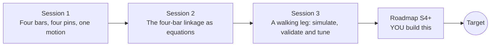

# openlinkage

[](https://github.com/KrunalPanchal1995/openlinkage/actions/workflows/ci.yml)   [](https://colab.research.google.com/github/KrunalPanchal1995/openlinkage/blob/main/sessions/session-01/lesson.ipynb) [](https://krunalpanchal1995.github.io/openlinkage/)

**Design a four-bar walking machine, Strandbeest style, in three sessions.**

openlinkage teaches how rigid bars joined by pins make a foot walk in an almost straight line, from one turning crank to a measured and tuned walking leg, using only Python and a browser.

- **Start from zero.** Session 1 needs only school geometry: circles, triangles and angles.
- **See it move.** Every session ships a slider app that runs in the browser, with labelled graphs.
- **Know you got it right.** Each session ends with a checkpoint that prints PASS or FAIL against hand calculations and a second method.
- **Build the missing half.** The repo stops at one tuned leg on purpose; the roadmap shows the path to a full walking machine.

[Target](#the-target) · [Who is this for](#who-is-this-for) · [Quick start](#quick-start) · [Sessions](#sessions) · [Roadmap](#roadmap) · [Contribute](#contribute) · [Explainer PDF](docs/explainer.pdf)

> **This repo is incomplete on purpose.** Sessions 1 to 3 are here and fully working. The finished Target below is a preview of what the community can build next. We show you the path, not the code. Sessions 4 and up are yours.

## The Target

Six identical legs, each a four-bar linkage driven by its own crank phase, carry a body across the ground while every foot leaves a trace of its looping path; all pins stay above the ground. Below the walker is a map of how straight the stance is for every pair of ground and rocker lengths: a narrow band where the foot moves almost in a straight line without digging in (red) and the crank still turns (grey). Your goal over the coming sessions: build the legs, find that valley yourself, and put them together into a machine that walks.


*Target: a six-legged walker built from one four-bar leg, with the foot paths traced and a straightness map*


*Map of stance straightness over the ground-to-crank and rocker-to-crank ratios*


*Foot paths of four legs on one scale: a flat but digging linkage, our Session 3 leg, the same leg with a smaller ground bar, and the Target leg*

Try it live:

- [Math Visual Studio: mechanisms and mobility (Atlas S108)](https://krunalpanchal1995.github.io/studio/#atlas?ch=S108&ex=1)
- [Math Visual Studio: rigid bodies and kinematic pairs (Atlas S107)](https://krunalpanchal1995.github.io/studio/#atlas?ch=S107&ex=1)

How the Target was made is shown only as a path in [promo/roadmap.md](promo/roadmap.md).

## Who is this for
**diploma / undergraduate to advanced undergraduate (levels 5-6).** Topic area: Mechanical Engineering.

Prerequisites:

- School geometry and trigonometry: circles, triangles, sine and cosine.
- Python 3.10 or newer; if `python --version` works, you are ready. PRIMER.md explains the rest.
- No prior GitHub, mechanics or linear algebra experience is needed (a 2 by 2 system is explained when it appears).

New to Python? Read [PRIMER.md](PRIMER.md) first (10 minutes).

## Quick start

No installation knowledge needed. You need [Git](https://git-scm.com/downloads) and [Python 3.10+](https://www.python.org/downloads/) (Windows: tick "Add Python to PATH"). On Mac and Linux type `python3` wherever this page says `python`.

```bash
git clone https://github.com/KrunalPanchal1995/openlinkage.git
cd openlinkage
python start.py 1
```

`start.py` creates a private environment, installs what is needed and runs Session 1 with its checkpoint. Next: `python start.py 2`, `python start.py 3`, or `python start.py test` to check everything. Only a checkpoint: `python start.py check 1`.

Four lines place the pin B of Session 1 by the law of cosines (they work as they are): Save it as `try.py` and run it with `python start.py run try.py` (this uses the private environment, where NumPy is installed):

```python
import numpy as np
D, c, d = 3.0, 4.0, 5.0                       # A to O4 distance, coupler, rocker
x = (c**2 - d**2 + D**2) / (2 * D)            # how far B lies along the line from A to O4
print(x, np.sqrt(c**2 - x**2))                # -> 0.0 4.0  so B is 4 units straight above A
```

Every session also opens in your browser with sliders (no install): [live apps](https://krunalpanchal1995.github.io/openlinkage/). Or use the Colab badge above for the notebook.

## Sessions

| # | Session | Model level | Time | Live app |
|---|---|---|---|---|
| 1 | [Four bars, four pins, one motion](sessions/session-01/README.md) | Level 1: conceptual interactive model | 60 min | [open](https://krunalpanchal1995.github.io/openlinkage/session-01/) |
| 2 | [The four-bar linkage as equations](sessions/session-02/README.md) | Level 2: mathematical engineering model | 75 min | [open](https://krunalpanchal1995.github.io/openlinkage/session-02/) |
| 3 | [A walking leg: simulate, validate and tune](sessions/session-03/README.md) | Level 3: simulation and validation | 90 min | [open](https://krunalpanchal1995.github.io/openlinkage/session-03/) |

Each session follows the same six steps: A real-world problem, B concept and theory, C visual explanation, D interactive simulation, E worked example and experiment, F assessment and design challenge. Each ends with `checkpoint.py`, which prints `PASS` or `FAIL` against reference numbers. Session 3 also contains the real-world mini-project: **Tune a walking leg for the flattest stance**.

## Architecture



| Folder or file | What is inside |
|---|---|
| `sessions/` | three sessions: README (A-F), `lesson.py`, notebook, live app, exercises, activity sheet, checkpoint |
| `promo/` | the Target: media, live links, and the roadmap (path only) |
| `docs/` | `explainer.tex` and the built `explainer.pdf` |
| `tests/` | runs every lesson and checkpoint headless |
| `start.py` | one command to set up and run anything |
| `QUALITY.md`, `RUBRIC.md` | the quality checklist and the scoring rubric |
| `.github/` | CI, PDF build, Pages deploy, issue and PR templates |

## Roadmap

| Milestone | What you will build | Difficulty |
|---|---|---|
| Session 4: Make the leg mountable | A search over ground, coupler, rocker and foot position that includes the lowest-pin height in the requirement list. | intermediate |
| Session 5: Walk at a steady speed | A speed-uniformity measure along the stance added to the leg search. | intermediate |
| Session 6: Many legs, one gait | A multi-leg walker model with a phase offset for each leg. | intermediate |
| Session 7: Tolerance budget | A Monte Carlo study of random bar-length errors. | advanced |
| Session 8: Go beyond four bars | A six- or eight-bar leg solved with the same circle-circle method. | advanced |

Full detail with a checkpoint per milestone: [promo/roadmap.md](promo/roadmap.md).

## Contribute
New to GitHub? Read [CONTRIBUTING.md](CONTRIBUTING.md); it starts from zero. Pick an issue labelled `good first issue`. Translations into Hindi, Telugu, Tamil and Malayalam are welcome.

<details>
<summary>Development</summary>

```bash
python start.py test        # runs every lesson and checkpoint
```
Lessons use `# %%` cell markers so they open as notebooks in VS Code. See [QUALITY.md](QUALITY.md) for the standard every session meets.
</details>

## License
MIT. See [LICENSE](LICENSE). Media in `promo/media` is (c) Krunal Panchal, CC BY 4.0.

## Acknowledgments
Part of the [PAN IIT OSS](https://hellofoss.tech-iitb.org/projects) open-source teaching collection, modelled on the structure of [openspline](https://github.com/openspline/openspline). Built on ideas from the Math Visual Studio at https://krunalpanchal1995.github.io/studio/.
