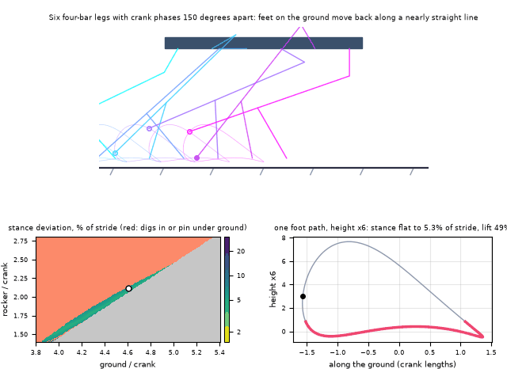
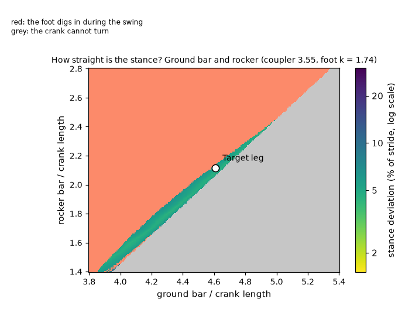
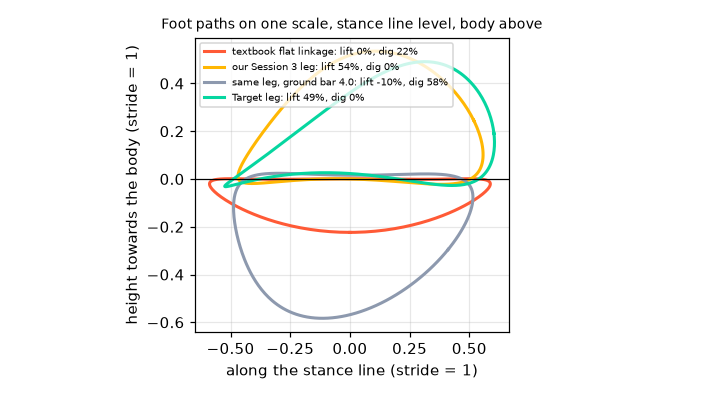

# What you are building toward

Six identical legs, each a four-bar linkage driven by its own crank phase, carry a body across the ground while every foot leaves a trace of its looping path; all pins stay above the ground. Below the walker is a map of how straight the stance is for every pair of ground and rocker lengths: a narrow band where the foot moves almost in a straight line without digging in (red) and the crank still turns (grey). Your goal over the coming sessions: build the legs, find that valley yourself, and put them together into a machine that walks.

*Target: a six-legged walker built from one four-bar leg, with the foot paths traced and a straightness map*

*Map of stance straightness over the ground-to-crank and rocker-to-crank ratios*

*Foot paths of four legs on one scale: a flat but digging linkage, our Session 3 leg, the same leg with a smaller ground bar, and the Target leg*

These results come from a private reference build. The code is not published; the roadmap shows the path so you can build your own.

Live links:

- [Math Visual Studio: mechanisms and mobility (Atlas S108)](https://krunalpanchal1995.github.io/studio/#atlas?ch=S108&ex=1)
- [Math Visual Studio: rigid bodies and kinematic pairs (Atlas S107)](https://krunalpanchal1995.github.io/studio/#atlas?ch=S107&ex=1)
