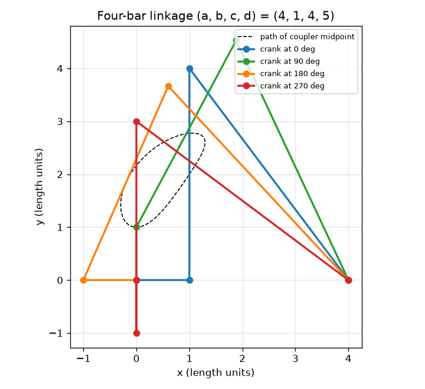
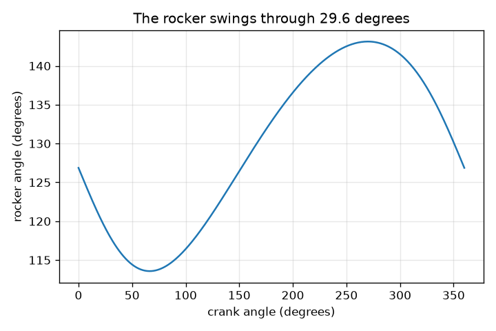

# Session 1: Four bars, four pins, one motion

*Level 1 (conceptual interactive model) · about 60 minutes · openlinkage*

> This is a simplified educational model. It is not a validated design tool and must not be used for real structures, electrical installations, vehicles, industrial processes or medical decisions.

**Prerequisites**

- School geometry: circles, triangles, angles.
- You have read PRIMER.md and run `python start.py 1` once.

**Learning objectives.** After this session you can:

- Explain why one turning bar (the crank) fixes the position of every other bar in a four-bar linkage.
- Place the pins of a four-bar linkage with two circles and check that the bar lengths never change.
- Read a graph of the rocker angle against the crank angle and find the rocker's swing.
- Describe the curve drawn by a coupler point and how its position on the bar changes the curve.

## A. Real-world problem
A windscreen wiper, a walking toy and a bicycle suspension all move by rigid bars joined at pins. Nobody pushes every bar: one motor turns one bar (the crank) and all the others follow in a fixed way. Even stranger, a point on the middle bar (the coupler) draws a curve, and that curve can be shaped to be almost straight, which is how some walking machines move their feet. How can a few stiff bars, joined at four pins, turn one steady rotation into a rocking motion and a looping path?

## B. Concept and theory
The frame (ground bar) holds two fixed pins O2 at (0, 0) and O4 at (a, 0). The crank (length b) turns about O2, so its free end A is at b(cos t, sin t). The coupler (length c) joins A to a pin B, and the rocker (length d) joins B to O4. So B is at distance c from A and at distance d from O4: it is where two circles cross. Two circles usually cross in two points, so there are two ways to assemble the linkage; we take the one to the left of the line from A to O4. Once the crank angle t is chosen, A, B and the rocker angle are all fixed: the linkage has one freedom. A plane bar has 3 freedoms (x, y, angle); a pin removes 2, and the ground bar is fixed, so n bars and j pins leave M = 3(n - 1) - 2j freedoms. For the four-bar, M = 3*3 - 2*4 = 1. At the extreme positions of the rocker, the crank and the coupler lie on one line, so B is at distance c + b or c - b from O2; the law of cosines then gives the rocker's swing.

| Symbol | Meaning | Unit |
|---|---|---|
| a | ground bar: distance O2 to O4 (a, b, c, d are lengths in any one unit) | length units |
| b | crank length (O2 to A) | length units |
| c | coupler length (A to B) | length units |
| d | rocker length (O4 to B) | length units |
| t | crank angle, from the +x axis | degrees |
| k | coupler point P = A + k (B - A), k = 0.5 is the middle | no unit |
| n, j, M | number of bars, number of pins, number of freedoms | no unit |

**Assumptions**

- All bars are rigid and the pins have no play or friction.
- Everything moves in one plane.
- We use the left-of-A-to-O4 assembly (the other assembly is the mirror image).
- Lengths for the example: a = 4, b = 1, c = 4, d = 5 (the crank is the shortest bar).

$$ \mathbf A=b(\cos t,\ \sin t),\qquad \lVert\mathbf B-\mathbf A\rVert=c,\qquad \lVert\mathbf B-\mathbf O_4\rVert=d $$

$$ M=3(n-1)-2j\qquad(\text{four-bar: }3\cdot 3-2\cdot 4=1) $$

$$ \cos\psi=\frac{a^2+d^2-r^2}{2ad},\qquad r=c+b\ \text{or}\ c-b\ \text{(the two extreme positions)} $$

$$ \text{swing}=\left|\psi_{c+b}-\psi_{c-b}\right| $$

## C. Visual explanation
The first figure shows the example linkage (a, b, c, d) = (4, 1, 4, 5) in four poses, with the dashed path of the coupler midpoint. In every pose the four bars have the same lengths; only the angles change. The second figure plots the rocker angle against the crank angle. One turn of the crank makes the rocker rock between 113.58 and 143.13 degrees, a swing of 29.55 degrees, and then the whole motion repeats.

*The linkage (4, 1, 4, 5) at four crank angles, with the path of the coupler midpoint.*

*Rocker angle against crank angle: a swing of 29.55 degrees.*

## D. Interactive simulation
Run the lesson (`python start.py 1`), then open the live app: [Session 1: a four-bar linkage](https://krunalpanchal1995.github.io/openlinkage/session-01/) (or `app.html` in this folder). Drag the crank angle slider and watch the other bars follow, then move the coupler point slider and watch the dashed curve change shape. Switch to the graph view and read the rocker angle.

**Challenge.** Turn the crank to the angle where the rocker leans furthest to the left (270 degrees) and put the coupler point on the pin B (k = 1).

## E. Worked example and experiment
**Problem.** For (a, b, c, d) = (4, 1, 4, 5) find the pin B and the rocker angle when the crank lies along the ground bar (t = 0). Then find the rocker's total swing.

1. At t = 0 the crank tip is A = (1, 0). The rocker pivot is O4 = (4, 0), so A is 3 units from O4.
2. B is 4 from A and 5 from O4. A triangle with sides 3, 4, 5 has a right angle between the sides 3 and 4, so B is straight above A: B = (1, 4).
3. The rocker points from O4 = (4, 0) to B = (1, 4), the vector (-3, 4). Its angle from the +x axis is atan2(4, -3) = 126.87 degrees.
4. Extremes: |O2 B| = c + b = 5 gives cos(psi) = (16 + 25 - 25)/40 = 0.4, psi = 66.42 degrees; |O2 B| = c - b = 3 gives cos(psi) = (16 + 25 - 9)/40 = 0.8, psi = 36.87 degrees.
5. Swing = 66.42 - 36.87 = 29.55 degrees. A sampled check of the rocker angle over a full turn gives the same swing.

**Answer.** B = (1, 4), rocker angle 126.87 degrees at t = 0, and the rocker swings through 29.55 degrees (between 113.58 and 143.13 degrees).

**Experiment.** Cut four strips of cardboard 4, 1, 4 and 5 cm long (holes at the ends), join them with paper fasteners, and pin the 4 cm ground strip to a board. Turn the 1 cm crank by hand, mark the rocker angle with a protractor at crank angles 0, 90, 180 and 270 degrees and compare with 126.87, 115.06, 132.84 and 143.13 degrees. Expect agreement within a few degrees. The differences come from hole spacing and slack in the fasteners: the model has perfectly rigid bars and pins of zero size.

## F. Assessment and design challenge
**Question type A: Conceptual.** Why does turning only the crank decide the position of the coupler and the rocker as well? What would have to be different for the linkage to need two motors?

Hint

Count the freedoms: M = 3(n - 1) - 2j. What does a pin remove?

Step-by-step solution

Each of the four pins removes 2 of the 3 freedoms a free plane bar has, and one bar is fixed to the ground, so M = 3*3 - 2*4 = 1: a single input fixes everything. Geometrically, once the crank angle is chosen A is known, and B must lie at distance c from A and d from O4, which leaves at most two points (two circles cross twice). To need two motors the linkage would need M = 2, for example a five-bar loop with 5 pins: M = 3*4 - 2*5 = 2.

**Question type B: Numerical.** For (a, b, c, d) = (4, 1, 4, 5) find the pin B and the rocker angle when the crank angle is 180 degrees.

Hint

A = (-1, 0), so A is 5 from O4. Use x = (c^2 - d^2 + D^2)/(2D) along the line from A, and h = sqrt(c^2 - x^2) across it.

Step-by-step solution

D = 5, x = (16 - 25 + 25)/10 = 1.6, h = sqrt(16 - 2.56) = 3.666. The line from A to O4 points along +x, so B = (-1 + 1.6, 3.666) = (0.6, 3.666). The rocker vector from O4 is (0.6 - 4, 3.666) = (-3.4, 3.666), so the angle is atan2(3.666, -3.4) = 132.84 degrees. Check: the distance from B to O4 is sqrt(11.56 + 13.44) = 5.

**Question type C: Graph and simulation interpretation.** In the graph of rocker angle against crank angle, at which crank angles is the rocker at its two extreme positions, and how large is the swing?

Hint

The extremes are the highest and lowest points of the curve. Think about when the crank and the coupler are on one straight line.

Step-by-step solution

The rocker angle is largest (143.13 degrees) at a crank angle of 270 degrees, where the crank is folded back against the coupler (|O2 B| = c - b = 3), and smallest (113.58 degrees) at a crank angle of about 66.4 degrees, where crank and coupler point the same way (|O2 B| = c + b = 5). The swing is 143.13 - 113.58 = 29.55 degrees.

**Question type D: Design and optimisation challenge.** Design: with a = 4, c = 4 and d = 5 the rocker must swing through at least 40 degrees. Choose a crank length from 1.0, 1.5 and 2.0 and justify your choice.

Hint

Compute the swing for each crank length with the law of cosines at the two extreme positions.

Step-by-step solution

The swings are 29.55 degrees (b = 1.0), 44.72 degrees (b = 1.5) and 60.49 degrees (b = 2.0). Only b = 1.5 and b = 2.0 reach 40 degrees. The smallest crank that works, b = 1.5, gives a swing of 44.72 degrees, a margin of about 4.7 degrees. b = 2.0 swings 60.49 degrees, much more than needed, so the rocker would move faster than the application requires. Assumption: only the swing matters here; Session 2 adds the transmission angle.

Score yourself with [RUBRIC.md](../../RUBRIC.md). Print the [activity sheet](activity_sheet.md) to work on paper.

## Common misconceptions
| Common misconception | What is actually true |
|---|---|
| The coupler is just a connecting rod that does nothing. | The coupler is the richest bar: each point on it draws its own curve, and a leg's foot is exactly such a point. |
| One crank angle can give any position of the rocker. | For fixed bar lengths one crank angle gives at most two rocker positions (the two circle crossings), and we follow one of them. |
| The rocker swing equals the crank swing. | The crank turns 360 degrees but the rocker only rocks through 29.55 degrees here; the motion type changes from rotation to oscillation. |
| A longer crank always makes the machine bigger but changes nothing else. | The crank length sets the rocker swing: 29.55, 44.72 and 60.49 degrees for b = 1, 1.5, 2. |

## Glossary
- **linkage**: bars joined by pins so that they move together
- **crank**: the bar that turns fully round about a fixed pin
- **coupler**: the middle bar joining crank and rocker; its points draw coupler curves
- **rocker**: the output bar that swings to and fro about a fixed pin
- **ground**: the fixed frame bar between the two fixed pins
- **degrees of freedom**: the number of independent inputs needed to fix a mechanism's position (mobility M)

## Finish
1. Do the three coding tasks in [exercises.md](exercises.md).
2. Run `python start.py 1` again after your changes. It ends with the checkpoint; when it prints `PASS`, you are done. (Checkpoint only: `python start.py check 1`.)

Next: [Session 2](../session-02/README.md)
