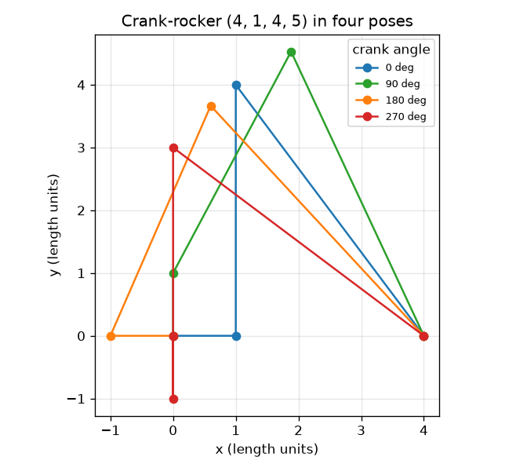
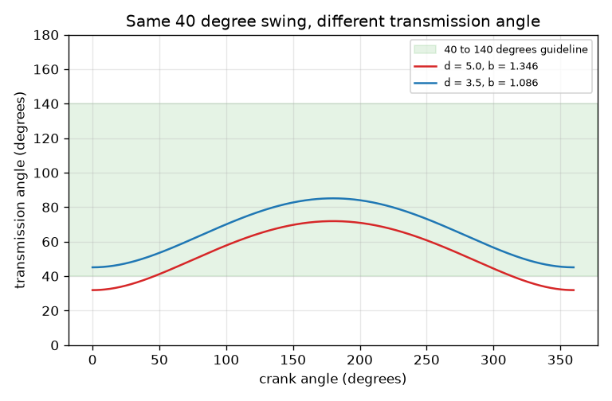

# Session 2: The four-bar linkage as equations

*Level 2 (mathematical engineering model) · about 75 minutes · openlinkage*

> This is a simplified educational model. It is not a validated design tool and must not be used for real structures, electrical installations, vehicles, industrial processes or medical decisions.

**Prerequisites**

- Session 1: pins, circles and the rocker swing.
- The law of cosines is used and explained in Section B.

**Learning objectives.** After this session you can:

- Apply Grashof's rule to classify a four-bar linkage and verify it by brute force.
- Solve the position problem two ways (circle-circle and loop closure with Newton's method) and compare.
- Compute and interpret the transmission angle, and say what the 40 to 140 degree guideline means.
- Solve a design problem: choose link lengths so the rocker swings through a given angle.

## A. Real-world problem
A workshop needs a crank that turns round and round to rock an output arm through exactly 40 degrees. Which bar lengths do we choose? Three questions decide it. Can the crank turn a full circle at all, or will it jam? Where is every pin for a given crank angle? And when the coupler pushes the rocker, does the push turn the rocker or just squeeze the pin? A linkage that swings correctly on paper can still lock in practice.

## B. Concept and theory
Name the bars ground a, crank b, coupler c, rocker d. Let s be the shortest, l the longest and p, q the other two. Grashof's rule: if s + l <= p + q, the shortest bar can make a full turn relative to its neighbours. Where the shortest bar sits decides the kind of motion: crank b gives a crank-rocker, ground a a double-crank, coupler c a double-rocker. If s + l > p + q no bar turns fully (triple-rocker), and equality is the change-point case. The position problem is solved by the circle crossing of Session 1, or by the loop-closure equation: walking round the loop O2, A, B, O4 returns to the start, which gives two equations for the two unknown angles of the coupler and the rocker (Newton's method solves them from a guess). The transmission angle mu is the angle between coupler and rocker at B: with D the distance from A to O4, cos(mu) = (c^2 + d^2 - D^2)/(2cd). At mu = 90 degrees all the push turns the rocker; near 0 or 180 degrees most of it squeezes the pin. A common design guideline keeps mu between about 40 and 140 degrees; it is a rule of thumb, not a law.

| Symbol | Meaning | Unit |
|---|---|---|
| a, b, c, d | ground, crank, coupler, rocker lengths | length units |
| s, l, p, q | shortest, longest and the two other bar lengths | length units |
| t2, t3, t4 | angles of the crank, coupler and rocker from the +x axis | radians |
| mu | transmission angle between coupler and rocker at B | degrees |
| D | distance from the crank tip A to the rocker pivot O4 | length units |
| psi | rocker angle measured from the ground line at O4 | degrees |

**Assumptions**

- Rigid bars, frictionless pins, plane motion (as in Session 1).
- Grashof's rule is a statement about which bar can turn fully; it says nothing about forces.
- The transmission angle guideline of 40 to 140 degrees is a common rule of thumb for force-carrying mechanisms.
- Example linkage: a = 4, c = 4 and the crank b and rocker d are chosen.

$$ s+l\le p+q\ \Rightarrow\ \text{the shortest bar can turn fully} $$

$$ b\,e(t_2)+c\,e(t_3)-d\,e(t_4)-(a,0)=(0,0),\qquad e(t)=(\cos t,\sin t) $$

$$ \cos\mu=\frac{c^2+d^2-D^2}{2cd} $$

$$ \text{swing}=\left|\arccos\frac{a^2+d^2-(c+b)^2}{2ad}-\arccos\frac{a^2+d^2-(c-b)^2}{2ad}\right| $$

## C. Visual explanation
The first figure plots the transmission angle against the crank angle for two rocker lengths that both make the rocker swing 40 degrees (a = 4, c = 4). With d = 5 the crank must be 1.346 and the transmission angle dips to 31.91 degrees, below the 40 degree guideline; with d = 3.5 the crank is 1.086 and the angle stays between 45.12 and 85.12 degrees, inside the green band. The second figure shows the crank-rocker (4, 1, 4, 5) in four poses.

*The crank-rocker (4, 1, 4, 5) in four crank positions.*

*Transmission angle against crank angle for two rocker lengths that both swing 40 degrees.*

## D. Interactive simulation
Run the lesson (`python start.py 2`), then open the live app: [Session 2: Grashof and the transmission angle](https://krunalpanchal1995.github.io/openlinkage/session-02/) (or `app.html` in this folder). Move the crank length and the rocker length sliders and watch the Grashof class, the swing and the smallest transmission angle in the readout. Find settings where the crank can no longer turn a full circle, then use the graph view to see the transmission angle.

**Challenge.** Make the rocker swing within 1 degree of 40 degrees while keeping the transmission angle inside the 40 to 140 degree guideline.

## E. Worked example and experiment
**Problem.** For (a, b, c, d) = (4, 1, 4, 5) and a crank angle of 90 degrees find B, the transmission angle, and check Grashof's rule.

1. Grashof: s = 1, l = 5, p + q = 4 + 4 = 8, and s + l = 6 <= 8. The shortest bar is the crank, so this is a crank-rocker.
2. At 90 degrees A = (0, 1) and O4 = (4, 0), so D^2 = 16 + 1 = 17 and D = 4.1231.
3. x = (c^2 - d^2 + D^2)/(2D) = (16 - 25 + 17)/8.2462 = 0.9701 and h = sqrt(16 - 0.9412) = 3.8806. The unit vector from A to O4 is (0.9701, -0.2425) and its left normal is (0.2425, 0.9701).
4. B = A + x e + h n = (0.9412 + 0.9412, 1 - 0.2353 + 3.7647) = (1.882, 4.529).
5. Transmission angle: cos(mu) = (c^2 + d^2 - D^2)/(2cd) = (16 + 25 - 17)/40 = 0.6, so mu = 53.13 degrees, inside the 40 to 140 degree guideline.

**Answer.** B = (1.882, 4.529); the linkage is a crank-rocker; mu = 53.13 degrees at this crank angle.

**Experiment.** Use your cardboard linkage from Session 1 (4, 1, 4, 5). Turn the crank until the rocker is hardest to move by pushing on the coupler, and compare with the crank angle where the model gives its smallest transmission angle (36.87 degrees at a crank angle of 0). Real joints have friction and play, so the real linkage starts to feel stiff earlier than the model predicts: the model treats pins as frictionless and bars as perfectly rigid.

## F. Assessment and design challenge
**Question type A: Conceptual.** Why does a linkage that satisfies Grashof's rule with the shortest bar as the coupler not let the crank turn a full circle?

Hint

Which bar turns fully in a Grashof linkage, and where is it?

Step-by-step solution

Grashof's rule says the shortest bar can make a full turn relative to its neighbours. The shortest bar here is the coupler, so it is the coupler that can turn fully relative to the crank and rocker, while the crank and the rocker only rock (a double-rocker). The example (4, 3, 1, 3.5) satisfies s + l = 5 <= p + q = 6.5, yet a brute-force test shows the crank cannot turn a full circle.

**Question type B: Numerical.** Classify the linkage (a, b, c, d) = (2, 5, 4, 6) with Grashof's rule. Which bar can turn fully?

Hint

Sort the four lengths and compare s + l with p + q.

Step-by-step solution

Sorted: 2, 4, 5, 6, so s = 2, l = 6, p + q = 4 + 5 = 9. s + l = 8 <= 9, so the linkage is Grashof. The shortest bar (2) is the ground, so it is a double-crank: both the crank and the rocker can turn fully.

**Question type C: Graph and simulation interpretation.** In the transmission-angle graph for d = 5 (crank 1.346) the lowest point is 31.91 degrees. At which crank angle does it occur, and does the linkage meet the 40 to 140 degree guideline?

Hint

The smallest angle occurs when the distance D from A to O4 is smallest.

Step-by-step solution

D is smallest when the crank points along the ground bar toward O4, at a crank angle of 0, where D = a - b. Then cos(mu) = (16 + 25 - D^2)/40 with D = 2.654, giving mu = 31.91 degrees. This is below 40 degrees, so the guideline is not met; the largest angle is 71.91 degrees. For d = 3.5 the range 45.12 to 85.12 degrees is inside the guideline.

**Question type D: Design and optimisation challenge.** Design: with a = 4 and c = 4 you may choose the rocker length d = 5 or d = 3.5. In each case find the crank length for a 40 degree swing, and choose one. Justify your choice.

Hint

Search for the crank length b that gives a 40 degree swing (the swing grows with b), then compute the smallest transmission angle.

Step-by-step solution

d = 5 needs b = 1.3459 and gives mu from 31.91 to 71.91 degrees (smallest value fails the 40 degree guideline). d = 3.5 needs b = 1.0860 and gives mu from 45.12 to 85.12 degrees, which passes. Both are Grashof crank-rockers. Choose d = 3.5. Trade-off: the shorter rocker is also a smaller machine; the price is a shorter crank, so the geometry is tighter and a small error in b changes the swing more. Assumption: the 40 to 140 degree guideline is the only force criterion.

Score yourself with [RUBRIC.md](../../RUBRIC.md). Print the [activity sheet](activity_sheet.md) to work on paper.

## Common misconceptions
| Common misconception | What is actually true |
|---|---|
| If s + l <= p + q, the crank always turns fully. | Only the shortest bar turns fully relative to its neighbours; the crank turns fully only if it (or the ground) is the shortest bar. |
| A bigger swing means a better linkage. | A larger swing needs a longer crank, which can push the smallest transmission angle below the guideline. |
| The transmission angle should be as small as possible, because small angles save material. | The best value is 90 degrees; near 0 or 180 degrees the coupler mostly squeezes the pin and the mechanism can jam. |
| Grashof's rule is exact for every real mechanism. | It is a statement about geometry of ideal rigid bars; clearances and friction change what works in practice, and equality (change-point) is delicate. |

## Glossary
- **Grashof's rule**: s + l <= p + q: the shortest bar can turn fully
- **crank-rocker**: a Grashof linkage whose shortest bar is the crank: full turn in, rocking out
- **double-crank**: a Grashof linkage whose shortest bar is the ground: both side bars turn fully
- **transmission angle**: the angle between coupler and rocker at their pin
- **loop closure**: the statement that walking round the loop of bars returns to the start
- **change-point**: the borderline case s + l = p + q, where the linkage can flip at a straight-line position

## Finish
1. Do the three coding tasks in [exercises.md](exercises.md).
2. Run `python start.py 2` again after your changes. It ends with the checkpoint; when it prints `PASS`, you are done. (Checkpoint only: `python start.py check 2`.)

Next: [Session 3](../session-03/README.md)
