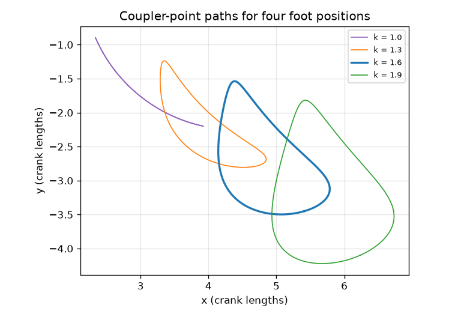
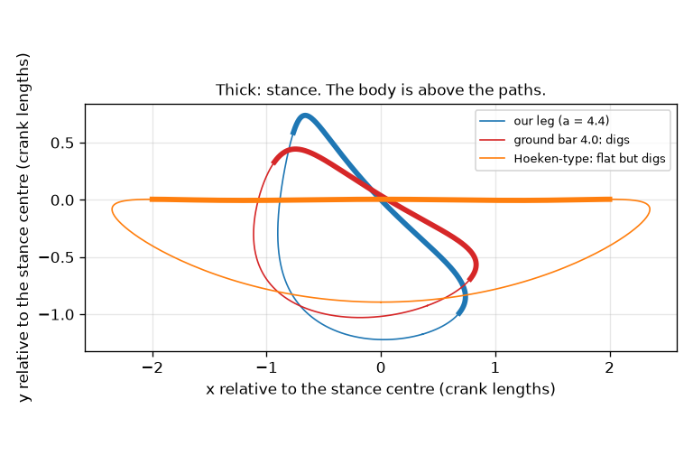
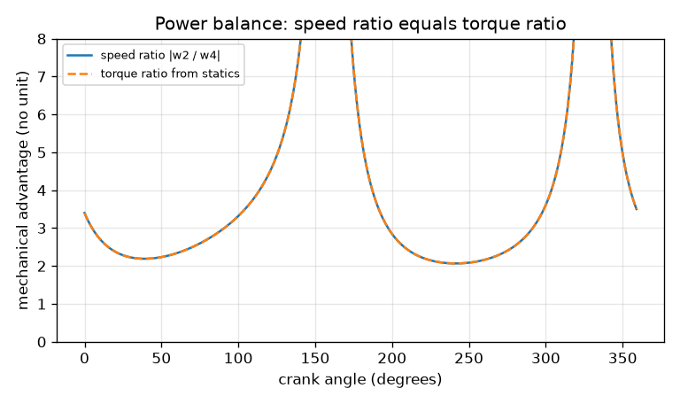

# Session 3: A walking leg: simulate, validate and tune

*Level 3 (simulation and validation) · about 90 minutes · openlinkage*

> This is a simplified educational model. It is not a validated design tool and must not be used for real structures, electrical installations, vehicles, industrial processes or medical decisions.

**Prerequisites**

- Session 1: pins, circles, rocker swing.
- Session 2: Grashof's rule, loop closure and the transmission angle.

**Learning objectives.** After this session you can:

- Simulate a full crank turn of a leg linkage and validate it with the loop-closure error and constant bar lengths.
- Compute the foot velocity by finite differences and by the analytic Jacobian, and compare; relate the speed ratio to mechanical advantage with a power balance.
- Measure stance straightness, stride, lift and dig, and see that a flat stance and a clear swing fight each other.
- Recognise a failure case (the crank locks at a dead centre) and tune a leg against a requirement list.

## A. Real-world problem
Theo Jansen's beach walkers and many walking toys move on legs that are only bars and pins. The foot is a point on the coupler. For a smooth walk the foot must move along an almost straight line while it is on the ground (the stance), so the body glides forward without bobbing. Then it must lift off and swing back WITHOUT digging into the ground. How straight can four bars make the stance? Why are the famous straight-line linkages not good legs? How far does the foot step and lift, and what happens when the bars are chosen badly and the crank locks?

## B. Concept and theory
Our leg is a four-bar with ground a, crank b = 1, coupler c = 3.5 and rocker d = 2.25, with the foot P on the extension of the coupler beyond B: P = A + k (B - A). Simulating means solving the position problem for many crank angles, then checking it (Validation 1): the loop-closure error must be below 1e-12 and the bar lengths must stay constant. Velocity is checked two ways (Validation 2). Finite differences move the crank a tiny step either side and divide. The analytic way differentiates the loop equation: for a crank speed w2 the coupler and rocker speeds w3, w4 solve a 2 by 2 linear system (the Jacobian), and the foot velocity follows. A third view uses the instant centre I24, where the coupler line meets the ground line: w4/w2 = x_I/(x_I - a). For an ideal linkage no power is lost, so torque_in * w_in = torque_out * w_out and the mechanical advantage is MA = w2/w4; statics (a two-force coupler) gives the same ratio from distances alone. A stance is a run of consecutive crank angles (180 degrees here, a duty factor of 0.5). Its deviation is the largest perpendicular distance of the foot from the best-fit straight line through the stance points; stride is the distance between the first and last stance point. In the rest of the cycle (the swing) the height above the stance line, positive towards the body, gives two numbers: lift (the highest point) and dig (how far the foot goes below the line, which would be inside the ground). Grashof's rule must hold for the crank to turn fully; if it fails, the crank locks at a dead centre where the coupler and rocker lie on one line (mu = 0 or 180 degrees).

| Symbol | Meaning | Unit |
|---|---|---|
| a, b, c, d | ground, crank, coupler, rocker (b = 1 sets the length unit, 'crank length') | crank lengths |
| k | foot position on the coupler: P = A + k (B - A) | no unit |
| w2, w3, w4 | angular speeds of crank, coupler, rocker | rad/s |
| I24 | instant centre: coupler line meets ground line at x_I | crank lengths |
| MA | mechanical advantage tau_out / tau_in = w2 / w4 | no unit |
| deviation, stride | straightness of the stance and step length | crank lengths |
| lift, dig | highest point of the swing above the stance line, and deepest point below it | crank lengths |
| duty factor | stance fraction of the cycle (stance span / 360 degrees) | no unit |

**Assumptions**

- Rigid bars, frictionless pins, massless bars: a simplified educational model, not a validated design tool.
- Only kinematics and ideal statics; no dynamics of the body or ground contact, no slipping.
- The crank turns at constant speed; the stance is the straightest run of 180 degrees of crank angle.
- The stance line is tilted against the ground bar (47 degrees for our leg). If the leg were mounted turned so that the stance line is level, its lowest pin would be 1.06 crank lengths under the ground (`pin_low`), so our leg is a foot-path study, not yet a buildable walker; the roadmap closes that gap.

$$ \mathbf P=\mathbf A+k(\mathbf B-\mathbf A),\qquad b\,e(t_2)+c\,e(t_3)=(a,0)+d\,e(t_4) $$

$$ \begin{pmatrix}-c\sin t_3 & d\sin t_4\\ c\cos t_3 & -d\cos t_4\end{pmatrix}\begin{pmatrix}\omega_3\\ \omega_4\end{pmatrix}=b\,\omega_2\begin{pmatrix}\sin t_2\\ -\cos t_2\end{pmatrix} $$

$$ \frac{\omega_4}{\omega_2}=\frac{x_I}{x_I-a},\qquad \tau_{\rm in}\omega_2=\tau_{\rm out}\omega_4\ \Rightarrow\ \mathrm{MA}=\frac{\omega_2}{\omega_4} $$

$$ \delta=\max_i\left|\mathbf n\cdot(\mathbf P_i-\bar{\mathbf P})\right|,\qquad \text{stride}=\lVert\mathbf P_{\rm last}-\mathbf P_{\rm first}\rVert $$

## C. Visual explanation
The first figure plots the coupler-point paths of the leg for four foot positions k = 1.0 to 1.9 (k = 1 is the pin B itself): the further the foot sits beyond B, the larger the loop. The second figure compares three feet on one scale with the stance drawn thick and the body above: our leg keeps its whole swing on the body side (lift 1.147, no dig); the same leg with the ground bar changed from 4.4 to 4.0 digs 1.164 below the stance line; the Hoeken-type straight-line linkage has a perfect stance but digs 0.894. The third figure shows the speed ratio |w2/w4| and the torque ratio from statics lying on top of each other, and rising steeply wherever the rocker is about to reverse (w4 near 0).

*Coupler-point paths of the leg for four foot positions k.*

*Three feet on one scale with the stance thick: our leg lifts, a smaller ground bar digs, the Hoeken-type leg digs.*

*Speed ratio and torque ratio from statics agree: the power balance holds.*

## D. Interactive simulation
Run the lesson (`python start.py 3`), then open the live app: [Session 3: a walking leg](https://krunalpanchal1995.github.io/openlinkage/session-03/) (or `app.html` in this folder). Move the ground bar and the foot position and read the stance deviation, stride, lift, dig and smallest transmission angle. In the graph view watch the foot height above the stance line: flat in the shaded window, positive (towards the body) outside it. Find bar sets for which the leg digs, and others for which the crank cannot turn a full circle.

**Challenge.** Reach a stance deviation below 3.1 percent of the stride with a lift of at least 15 percent and no dig (look near a = 4.5).

## E. Worked example and experiment
**Problem.** For the leg (a, b, c, d) = (4.4, 1, 3.5, 2.25) with k = 1.6, find B and the foot at crank angle 0, then the rocker speed ratio by the instant centre and the mechanical advantage.

1. Crank angle 0: A = (1, 0), O4 = (4.4, 0), so D = 3.4. x = (c^2 - d^2 + D^2)/(2D) = (12.25 - 5.0625 + 11.56)/6.8 = 2.757 and h = sqrt(12.25 - 2.757^2) = 2.156.
2. The foot hangs below the frame (the -1 assembly): B = (1 + 2.757, -2.156) = (3.757, -2.156). The foot is P = A + 1.6 (B - A) = (1 + 4.411, -3.450) = (5.411, -3.450).
3. The coupler line passes through A, which lies on the ground line y = 0, so the instant centre is I24 = A = (1, 0), x_I = 1.
4. w4/w2 = x_I/(x_I - a) = 1/(1 - 4.4) = -5/17 = -0.294. The rocker turns the other way, at 0.294 times the crank speed.
5. Power balance: MA = w2/w4 in magnitude = 17/5 = 3.4. Statics: the coupler direction is (0.788, -0.616); the torque arm about O2 is 0.616 and about O4 is 2.094; the ratio 2.094/0.616 = 3.4. The two methods agree.

**Answer.** B = (3.757, -2.156), foot (5.411, -3.450), w4/w2 = -5/17, and the ideal mechanical advantage is 3.4 (output torque 3.4 times input torque, output speed 0.294 times input speed).

**Experiment.** Build the leg from cardboard strips (crank 2 cm, ground 8.8 cm, coupler 7 cm, rocker 4.5 cm, foot at 11.2 cm from A) and trace the foot path with a pencil taped at P. Compare the stance with a ruler. The model predicts a deviation of 0.166 crank lengths (3.3 mm for a 2 cm crank); expect a larger wobble in the real strips. The model has rigid bars and exact lengths; real holes, slack and bending add errors, and Step 5 shows how a change of the bars moves the numbers.

## Real-world application and mini-project: Tune a walking leg for the flattest stance
A small walker needs a leg that never digs into the ground during the swing (dig at most 0.5 percent of the stride), lifts the foot at least 15 percent of the stride, keeps the smallest transmission angle at or above 40 degrees (the common guideline), and keeps the stance (180 degrees of crank) as straight as possible. The crank is 1, the coupler 3.5 and the rocker 2.25. Our leg (ground 4.4, foot k = 1.6) is acceptable but its stance is 7.74 percent of its stride off straight. Use `tune_leg` from Session 3 to search the ground bar a (3.6 to 5.2) and the foot position k (1.0 to 2.0).

**Deliverable:** A script that prints the best five acceptable legs (deviation percent, a, k, lift percent, dig percent, stride, smallest transmission angle), names the winner, and saves a picture of its foot path with the stance highlighted and the stride and deviation in the title.

**Success looks like:** The winner is a = 4.5 and k = 1.4 with stance deviation 2.94 percent of its 2.182 stride, lift 37.1 percent, no dig and smallest transmission angle 71.3 degrees.

## F. Assessment and design challenge
**Question type A: Conceptual.** A Hoeken-type linkage (ground 2, crank 1, coupler 2.5, rocker 2.5, foot at k = 2) has a much flatter stance than our leg. Why is it not a good leg as it stands?

Hint

Look at the dig, not only the deviation.

Step-by-step solution

Its stance deviation is only 0.125 percent of the stride (against 7.74 percent for our leg), but its dig is 0.894: the rest of its path lies below the stance line on the far side from the body, so a foot standing on the ground along that line would have to dig into the ground during the swing. A leg needs a flat stance and a swing on the body side, so both measures matter.

**Question type B: Numerical.** Our leg has a stance deviation of 0.1658 and a stride of 2.143 crank lengths. Express the deviation as a percentage of the stride. If the crank is 0.05 m long and turns once per second, what are the stride in metres and the mean foot speed during the stance (stance is half of the turn)?

Hint

Percent = 100 * deviation / stride. The stance lasts duty factor times one turn.

Step-by-step solution

100 * 0.1658 / 2.143 = 7.74 percent. Stride = 2.143 * 0.05 = 0.107 m. The stance lasts 0.5 s, so the mean speed is 0.107 / 0.5 = 0.214 m/s. Sanity check: the crank tip moves at 2 pi * 0.05 = 0.314 m/s, and the foot, which is carried on a longer arm but only travels along a short line, is slower: plausible.

**Question type C: Graph and simulation interpretation.** In the mechanical-advantage figure the curve is 3.4 at crank angle 0 and rises steeply at some angles. What does 3.4 mean, and what is happening to the rocker where the curve shoots up?

Hint

Use MA = w2/w4 and think about what w4 does at those angles.

Step-by-step solution

MA = 3.4 means the ideal output torque is 3.4 times the input torque while the rocker turns at 1/3.4 = 0.294 of the crank speed (the speed ratio is -5/17). The curve shoots up where the rocker is about to reverse: its speed w4 goes through zero, so w2/w4 becomes very large. An ideal linkage would then multiply the torque hugely, but real friction, play and bar strength limit this.

**Question type D: Design and optimisation challenge.** Design: the leg must dig at most 0.5 percent of its stride, lift at least 15 percent and keep the smallest transmission angle at or above 40 degrees, with the stance as straight as possible. Which (a, k) in the mini-project grid wins, and how risky is it?

Hint

Use tune_leg; then look at the leg next to it in the grid, for example a = 4.5 with k = 1.3.

Step-by-step solution

Searching a from 3.6 to 5.2 (step 0.1) and k from 1.0 to 2.0 (step 0.05) with coupler 3.5 and rocker 2.25, the flattest acceptable leg is a = 4.5, k = 1.4: deviation 2.94 percent of its 2.182 stride, lift 37.1 percent, no dig, smallest transmission angle 71.3 degrees. Our leg (a = 4.4, k = 1.6) is acceptable too, but 2.6 times less straight (7.74 percent). Risk: the winner sits next to a cliff. At a = 4.5 but k = 1.3 the lift is -1.7 percent (the swing has flipped to the wrong side), and with 3 percent random errors in all bars the tuned leg digs in more than 7 percent of 1000 trials. Trade-off: a flatter stance costs margin against build errors.

Score yourself with [RUBRIC.md](../../RUBRIC.md). Print the [activity sheet](activity_sheet.md) to work on paper.

## Common misconceptions
| Common misconception | What is actually true |
|---|---|
| The flattest stance makes the best leg. | A Hoeken-type leg is almost perfectly flat (0.125 percent) but digs 0.894 into the ground during the swing; a leg needs a flat stance and a swing on the body side. |
| If the simulation looks right it is right. | Check it: loop-closure error below 1e-12, constant bar lengths, and a second method (finite differences against the Jacobian). |
| Small errors in the bars always cause small changes. | A 1 percent error changes stride and deviation only by a few percent, but a bigger change can flip the swing to the other side: ground bar 4.0 instead of 4.4 makes our leg dig 1.164. |
| A good transmission angle makes the leg good. | Our leg has a smallest transmission angle of 68.6 degrees and is a fine linkage, yet its stance is 7.74 percent of the stride off straight: flatness is a separate property. |

## Glossary
- **stance**: the part of the cycle when the foot is on the ground, moving along a line
- **swing**: the part of the cycle when the foot is lifted and returns
- **duty factor**: stance fraction of the cycle
- **stride**: distance the foot moves along the line in one stance
- **lift**: how high the foot rises above the stance line, towards the body, in the swing
- **dig**: how far the foot goes below the stance line in the swing (it would be inside the ground)
- **instant centre**: the point about which the coupler seems to turn at that instant
- **mechanical advantage**: output torque divided by input torque; for an ideal linkage equal to w_in / w_out
- **dead centre**: a position where the coupler and rocker are in one line and the crank cannot push further

## Finish
1. Do the three coding tasks in [exercises.md](exercises.md).
2. Run `python start.py 3` again after your changes. It ends with the checkpoint; when it prints `PASS`, you are done. (Checkpoint only: `python start.py check 3`.)

Next: the [roadmap](../../promo/roadmap.md). Session 4 is yours to build.
